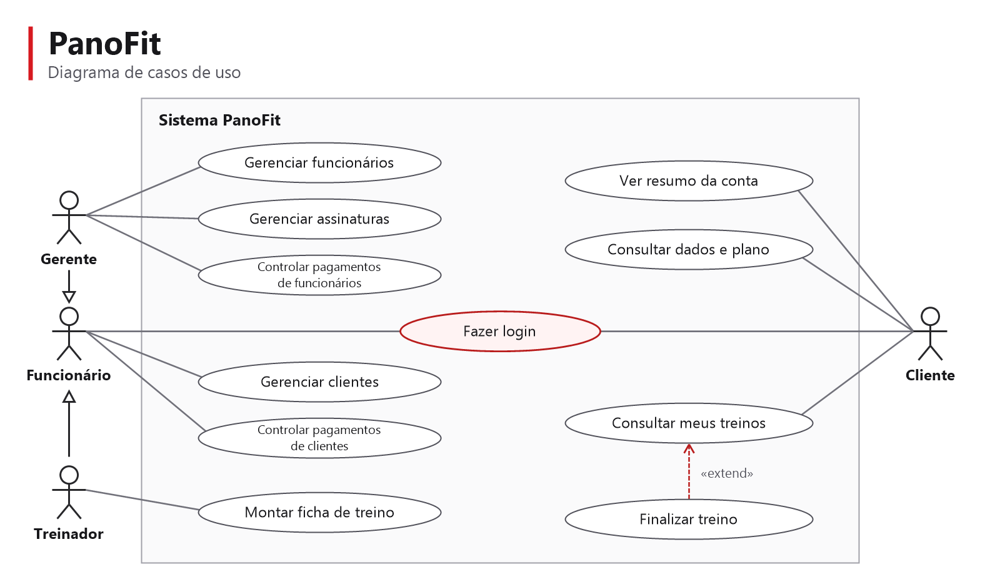

# PanoFit

PanoFit é um projeto acadêmico de gestão de academias. O aplicativo desktop reúne cadastro de clientes e funcionários, planos de assinatura, controle de pendências e fichas de treino. A interface foi desenvolvida em Java Swing e os dados são armazenados no MySQL via JDBC.

## Perfis de acesso

| Perfil | Funcionalidades |
| --- | --- |
| Gerente | Gerencia clientes, funcionários e planos de assinatura. Atualiza a situação dos pagamentos de clientes e funcionários. |
| Treinador | Gerencia clientes, atualiza a situação dos pagamentos de clientes e monta fichas de treino por aluno e dia da semana. |
| Cliente | Visualiza o resumo da conta, consulta seus dados e seu plano, e acompanha a ficha de treino semanal. |

O acesso usa CPF e senha. Na área do cliente, o botão **Finalizar treino** exibe uma confirmação na tela.

## Diagrama de casos de uso

No diagrama, **Funcionário** representa as ações compartilhadas por gerente e treinador.

## Como executar

### Pré-requisitos

- JDK 21 ou posterior.
- MySQL em execução. A configuração de exemplo usa `localhost:3306`.
- NetBeans com suporte a projetos Java Ant ou VS Code com o Extension Pack for Java. O driver MySQL Connector/J já está em `PanoFit/lib/`.

### Banco de dados

1. Execute [`database/database.sql`](database/database.sql) no MySQL Workbench ou no cliente MySQL para criar o banco `PanoFit` e suas tabelas.
2. Para experimentar o aplicativo com dados fictícios, execute [`database/seed_teste.sql`](database/seed_teste.sql). O script cadastra um gerente, um cliente e uma ficha de treino de exemplo.
3. Copie `PanoFit/src/db.properties.example` para `PanoFit/src/db.properties`. Ajuste `db.host`, `db.porta`, `db.banco`, `db.usuario` e `db.senha` conforme seu ambiente. Use em `db.banco` o nome criado pelo script, `PanoFit`. O arquivo com suas credenciais é ignorado pelo Git.

### Aplicativo

1. Abra a pasta interna `PanoFit/` no NetBeans ou no VS Code.
2. Execute a classe principal `panofit.PanoFit`. No VS Code, use **Run and Debug → PanoFit**.
3. Entre com um cadastro existente no banco. Se você executou a carga de teste, os CPFs e as senhas de demonstração estão nos comentários do script.

Para testar o perfil de treinador, use a tela **Funcionários** no painel do gerente e cadastre um funcionário com o cargo **Treinador**.

## Estrutura do repositório

- `PanoFit/src/` contém o código Java, os formulários Swing e os recursos da interface.
- `PanoFit/lib/` contém o driver JDBC.
- `PanoFit/nbproject/` e `PanoFit/.vscode/` contêm as configurações dos ambientes de desenvolvimento.
- `database/` contém o esquema e a carga de teste.
- `docs/` contém os diagramas do projeto.
